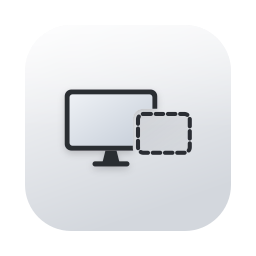
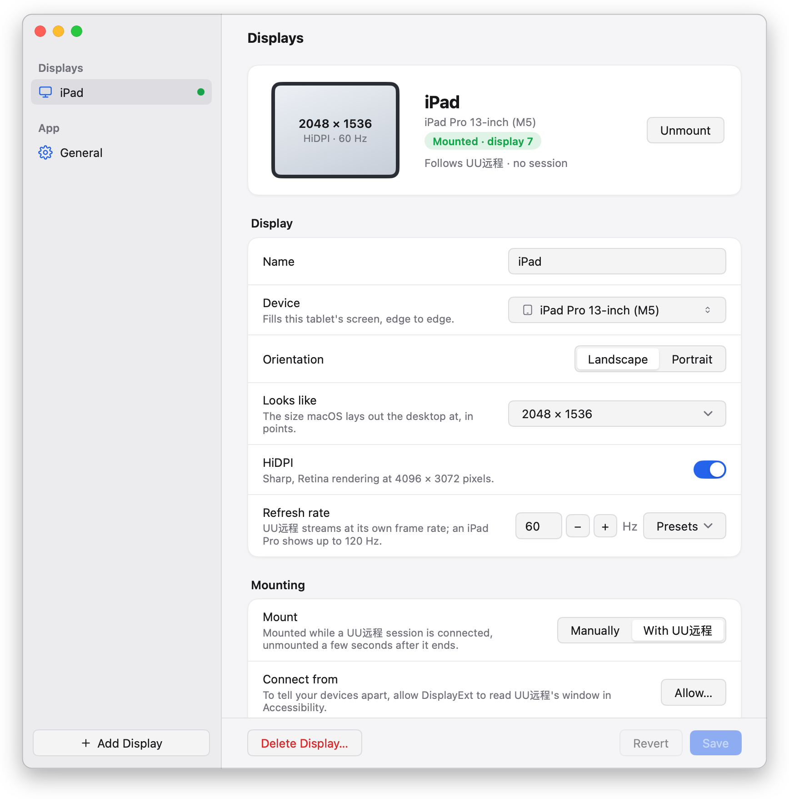
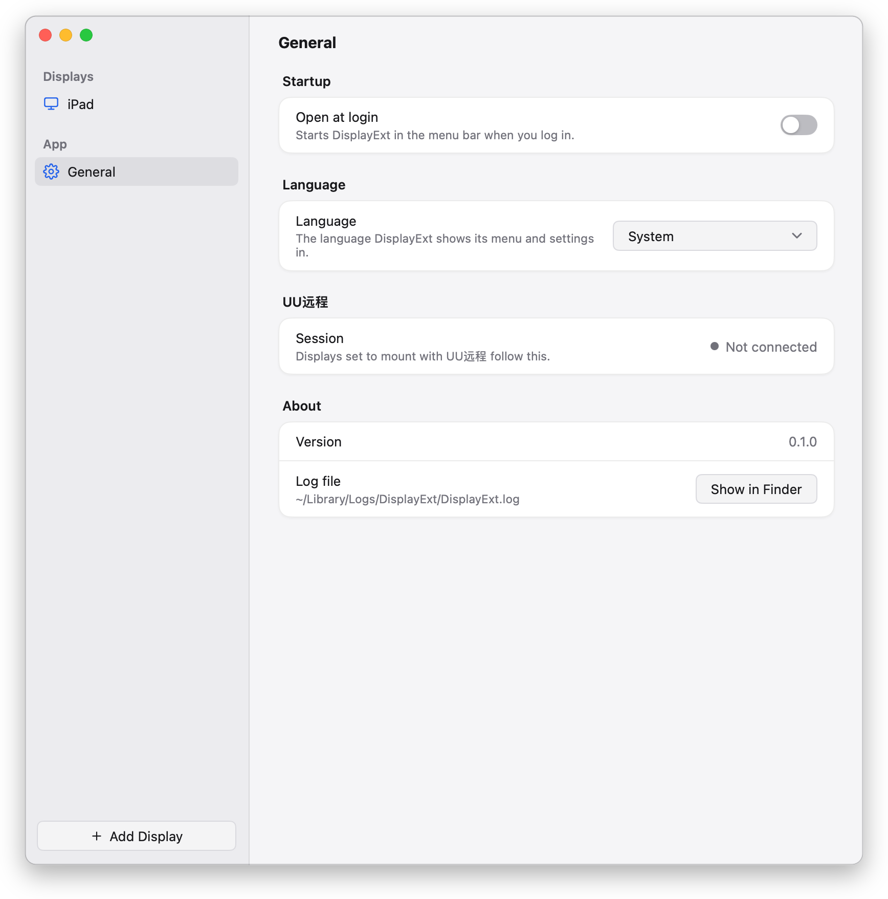

<p align="center">
  
</p>

<h1 align="center">DisplayExt</h1>

<p align="center">
  A small macOS menu bar app that creates virtual displays,<br>
  and mounts one automatically while a UU远程 session is connected.
</p>

<p align="center">
  <b>English</b> · <a href="README.zh-CN.md">简体中文</a>
</p>

<p align="center">
  <a href="https://github.com/tacshi/DisplayExt/actions/workflows/ci.yml"></a>
  <a href="https://github.com/tacshi/DisplayExt/releases/latest"></a>
  <a href="LICENSE"></a>
</p>

<picture>
  <source media="(prefers-color-scheme: dark)" srcset="docs/images/settings-dark.png">
  
</picture>

## Why

Controlling a Mac from an iPad Pro with UU远程 works best when the Mac has a
display shaped like the iPad: 4:3, with Retina-sharp text. Apps such as
BetterDisplay can create one, alongside many features you may never use.
DisplayExt does just this one job, and does it from the menu bar.

## Features

- **Virtual displays at any aspect ratio.** Presets for 4:3 (iPad Pro
  12.9″/13″), 16:10, 16:9, 3:2 and 21:9, or any ratio of your own, such as
  2420 : 1668 for an 11″ iPad Pro.
- **HiDPI.** "Looks like" 2048 × 1536, rendered at 4096 × 3072 pixels.
- **Any refresh rate** from 1 to 240 Hz, with presets up to 144 Hz.
- **Mounts with UU远程.** A display can follow UU远程 sessions: it is mounted
  as a session connects, and unmounted a few seconds after it ends.
- **Lives in the menu bar.** Mount and unmount from the menu; the icon fills
  in while a display is mounted. No Dock icon.
- **Opens at login**, speaks English and Simplified Chinese, and follows
  light and dark mode.
- **Small.** A pure Go app, about 10 MB, built with
  [MyGo](https://github.com/egoist/mygo).

## Requirements

- macOS 13 or later. Tested on macOS 27 on Apple silicon.
- UU远程 4.47 or later for mounting with sessions. With other remote apps,
  mount displays from the menu.

## Install

1. Download `DisplayExt-<version>-universal.dmg` from the
   [latest release](https://github.com/tacshi/DisplayExt/releases/latest).
   It runs on every Mac; the `arm64` (Apple silicon) and `amd64` (Intel)
   images are smaller.
2. Open it and drag DisplayExt to Applications.

Releases are signed with a Developer ID and notarized by Apple. Each release
lists the images' checksums in `SHA256SUMS`.

DisplayExt keeps itself up to date: a few seconds after it starts, and every
4 hours after that, it looks for a newer release and downloads it in the
background. The menu then offers **Restart to Update**. **Check for Updates…**
in the menu looks right away and shows the release notes.

## Use

1. Open DisplayExt. Its icon appears in the menu bar; choose **Settings…**.
2. The first launch adds a display named **iPad**: 4:3, looks like
   2048 × 1536, HiDPI, 60 Hz, mounted **With UU远程**. Change it, or add
   more with **Add Display**.
3. Connect to the Mac from the iPad with UU远程. DisplayExt mounts the
   display within a few seconds; choose it in UU远程's screen switcher.
   Disconnect, and it is unmounted.
4. To mount a display by hand, tick it in the menu, or click **Mount** in
   Settings. Displays set to **Manually** remember whether they were mounted
   across launches.

Turn on **Open at login** on the General page, where you can also choose the
language and see whether a UU远程 session is connected.

<picture>
  <source media="(prefers-color-scheme: dark)" srcset="docs/images/general-dark.png">
  
</picture>

## How it works

- **Virtual displays.** macOS has no public API that creates a display.
  DisplayExt uses CoreGraphics' private `CGVirtualDisplay` classes, as
  BetterDisplay, DeskPad and UU远程 itself do, called from pure Go through
  [purego](https://github.com/ebitengine/purego), with no cgo.
- **One process per display.** Each mounted display lives in a small helper
  process, the app's own executable started in a helper mode. Unmounting
  ends that process, which always removes the display, even after macOS
  changed its mode; and if DisplayExt quits or crashes, its displays go with
  it.
- **UU远程 sessions.** macOS has no system-wide "remote session" state for
  third-party apps. While a session is connected, UU远程's `UURemoteServer`
  holds a power assertion named `UURemote Disable Display Sleep`; DisplayExt
  looks for it every two seconds and waits five seconds after it goes before
  unmounting, so a brief reconnect leaves the display alone.

## Good to know

- A private API can change in any macOS release. If it does, DisplayExt says
  so in its menu and settings instead of crashing.
- UU远程's session signal is not a public interface either. It was verified
  with UU远程 4.47; `go run ./cmd/uuwatch` prints what DisplayExt sees.
- macOS remembers each display's arrangement and resolution by its identity.
  Every display keeps one identity for life, so it comes back where you put
  it. macOS also writes one color profile per identity to
  `/Library/ColorSync/Profiles/Displays`.
- Settings are in `~/Library/Application Support/DisplayExt/config.json`,
  the log in `~/Library/Logs/DisplayExt/DisplayExt.log`. If the settings
  file can't be read, DisplayExt keeps it beside the new one as
  `config-damaged-<date>.json` and starts over with its defaults.
- A display that fails to mount is not tried again until you turn it off and
  on, change its settings, or a new UU远程 session starts.

## Build from source

You need macOS and Go 1.27 or later.

```bash
git clone https://github.com/tacshi/DisplayExt.git
cd DisplayExt
make test
make debug
```

`make debug` builds `build/mac-debug/DisplayExt Debug.app`, which runs beside
a released copy with its own settings and displays.

| Command | What it does |
|---|---|
| `make check` | gofmt, golangci-lint, govulncheck, gosec and a syntax check of the scripts |
| `make test` | the tests with the race detector, and `mygo vet` |
| `make debug` | DisplayExt Debug, signed ad hoc (`ARCH=x64` for Intel) |
| `make release` | signed, notarized disk images for arm64, amd64 and universal (`VERSION=`, `ARCH=`) |
| `make publish` | builds, tags and publishes a release on GitHub (`VERSION=`, `DRY_RUN=1`) |
| `make icons` | renders the app and menu bar icons from `design/` |
| `make screenshots` | renders the images in `docs/images` |
| `make clean` | removes `build/` |

`cmd/vdspike` checks which ways of creating a virtual display a Mac accepts,
which is the first thing to run on a new macOS.

## Releases

Releases are built, signed and notarized on a Mac with the Developer ID in its
keychain, then published to GitHub:

```bash
make publish VERSION=0.2.0 DRY_RUN=1
make publish VERSION=0.2.0
```

[`scripts/publish.sh`](scripts/publish.sh) checks that the commit is on
`main`, pushed and clean, and that the version comes after the last release.
It builds the disk images and puts them with `SHA256SUMS` on a draft release,
with the signed update archives and manifests that installed copies update
from, then tags the commit, pushes the tag and publishes the release. The notes are
the version's section of `CHANGELOG.md`, or are drafted from the commits for
review. A dry run checks and shows the notes and the steps.

It signs with the keychain's Developer ID Application identity, or
`DEVELOPER_ID_APPLICATION`, and notarizes with the notarytool keychain profile
`DisplayExt`, or `DISPLAYEXT_NOTARY_PROFILE`, made once with:

```bash
xcrun notarytool store-credentials DisplayExt --apple-id <id> --team-id <team>
```

Updates are signed with the key in
`~/Library/Application Support/mygo/update-keys/DisplayExt/mygo-update.key`,
or the file `DISPLAYEXT_UPDATE_KEY`, or `MYGO_UPDATER_PRIVATE_KEY`. Its public
half is `updates.publicKey` in [`mygo.json`](mygo.json). Installed copies only
accept updates signed with it, so keep a copy somewhere safe. Debug builds
never update themselves.

## Translations

The texts are in [`locales/en.json`](locales/en.json) and
[`locales/zh-Hans.json`](locales/zh-Hans.json), in ICU MessageFormat. Add a
language by adding its catalog, then check it with `go tool mygo i18n check`.

## Acknowledgements

The virtual display code follows the approach of
[go-macos/virtualdisplay](https://github.com/go-macos/virtualdisplay)
(BSD-3-Clause) and Chromium's `virtual_display_util_mac.mm`. The app is built
with [MyGo](https://github.com/egoist/mygo).

## License

[MIT](LICENSE) © 2026 Rocky Shi
