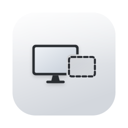
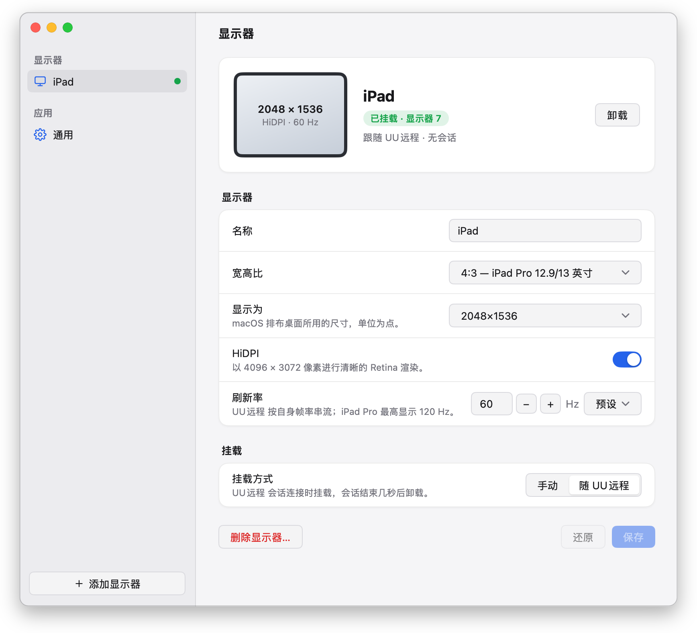

<p align="center">
  
</p>

<h1 align="center">DisplayExt</h1>

<p align="center">
  一款小巧的 macOS 菜单栏应用：创建虚拟显示器，<br>
  并在 UU远程 会话连接时自动挂载。
</p>

<p align="center">
  <a href="README.md">English</a> · <b>简体中文</b>
</p>

<p align="center">
  <a href="https://github.com/tacshi/DisplayExt/actions/workflows/ci.yml"></a>
  <a href="https://github.com/tacshi/DisplayExt/releases/latest"></a>
  <a href="LICENSE"></a>
</p>

<picture>
  <source media="(prefers-color-scheme: dark)" srcset="docs/images/settings-dark.zh-Hans.png">
  
</picture>

## 为什么做它

用 iPad Pro 通过 UU远程 控制 Mac 时，如果 Mac 上有一块和 iPad 形状一致的显示器（4:3、Retina
级清晰度），体验会好很多。BetterDisplay 等应用可以创建这样的显示器，但同时附带许多你可能用不到的功能。
DisplayExt 只做这一件事，并且全部在菜单栏里完成。

## 功能

- **任意宽高比的虚拟显示器。** 内置 4:3（iPad Pro 12.9/13 英寸）、16:10、16:9、3:2、21:9
  预设，也可以自定义任意比例，例如 11 英寸 iPad Pro 的 2420 : 1668。
- **HiDPI。** 显示为 2048 × 1536，以 4096 × 3072 像素渲染。
- **任意刷新率**，范围 1–240 Hz，并提供最高 144 Hz 的预设。
- **随 UU远程 挂载。** 显示器可以跟随 UU远程 会话：会话连接时挂载，会话结束几秒后卸载。
- **常驻菜单栏。** 在菜单中挂载、卸载显示器；有显示器挂载时图标会变为实心。不占用程序坞。
- **登录时打开**，支持英文和简体中文，跟随浅色与深色模式。
- **小巧。** 纯 Go 编写，约 10 MB，基于 [MyGo](https://github.com/egoist/mygo) 构建。

## 系统要求

- macOS 13 或更高版本。已在 Apple 芯片的 macOS 27 上测试。
- 随会话自动挂载需要 UU远程 4.47 或更高版本。使用其他远程软件时，可以在菜单中手动挂载。

## 安装

1. 从[最新版本](https://github.com/tacshi/DisplayExt/releases/latest)下载
   `DisplayExt-<版本>-universal.dmg`。它适用于所有 Mac；`arm64` 和 `x64` 版本体积更小。
2. 打开磁盘映像，把 DisplayExt 拖到“应用程序”文件夹。

发布版本均使用 Developer ID 签名并经过 Apple 公证。每个版本都在 `SHA256SUMS` 中列出了磁盘映像的校验和。

## 使用

1. 打开 DisplayExt，它的图标会出现在菜单栏中；选择 **设置…**。
2. 首次启动时会添加一个名为 **iPad** 的显示器：4:3，显示为 2048 × 1536，HiDPI，60 Hz，挂载方式为
   **随 UU远程**。你可以修改它，也可以用 **添加显示器** 再添加更多。
3. 在 iPad 上用 UU远程 连接这台 Mac。DisplayExt 会在几秒内挂载显示器；在 UU远程 的屏幕切换中选择它即可。
   断开连接后，显示器会被卸载。
4. 想手动挂载时，在菜单中勾选显示器，或在设置中点按 **挂载**。挂载方式为 **手动** 的显示器会在下次启动时恢复之前的挂载状态。

在“通用”页面中可以打开 **登录时打开**、选择界面语言，并查看 UU远程 会话是否已连接。

<picture>
  <source media="(prefers-color-scheme: dark)" srcset="docs/images/general-dark.zh-Hans.png">
  
</picture>

## 工作原理

- **虚拟显示器。** macOS 没有创建显示器的公开 API。DisplayExt 与 BetterDisplay、DeskPad 以及
  UU远程 本身一样，使用 CoreGraphics 中私有的 `CGVirtualDisplay` 类，并通过
  [purego](https://github.com/ebitengine/purego) 在纯 Go 中调用，无需 cgo。
- **每个显示器一个进程。** 每个已挂载的显示器都运行在一个小的辅助进程中（即以辅助模式启动的应用自身）。
  卸载时结束该进程，显示器总会随之移除，即使 macOS 已经改变过它的显示模式；DisplayExt 退出或崩溃时，
  它创建的显示器也会一并消失。
- **UU远程 会话。** macOS 没有面向第三方应用的全局“远程会话”状态。会话连接期间，UU远程 的
  `UURemoteServer` 会持有一个名为 `UURemote Disable Display Sleep` 的电源断言；DisplayExt 每两秒检查一次，
  并在断言消失五秒后才卸载显示器，因此短暂的重连不会影响显示器。

## 须知

- 私有 API 可能在任何 macOS 版本中发生变化。届时 DisplayExt 会在菜单和设置中提示不可用，而不会崩溃。
- UU远程 的会话信号同样不是公开接口，目前在 UU远程 4.47 上验证过；运行 `go run ./cmd/uuwatch`
  可以查看 DisplayExt 检测到的状态。
- macOS 会按显示器的标识记住它的排列位置和分辨率。DisplayExt 为每个显示器保留固定的标识，
  所以它总会回到你摆放的位置。macOS 还会为每个标识在 `/Library/ColorSync/Profiles/Displays`
  中写入一个颜色描述文件。
- 设置保存在 `~/Library/Application Support/DisplayExt/config.json`，日志位于
  `~/Library/Logs/DisplayExt/DisplayExt.log`。如果设置文件无法读取，DisplayExt
  会把它另存为同目录下的 `config-damaged-<日期>.json`，并恢复默认设置。
- 挂载失败的显示器不会自动重试，直到你将它关闭再打开、修改它的设置，或开始新的 UU远程 会话。

## 从源码构建

需要 macOS 和 Go 1.27 或更高版本。

```bash
git clone https://github.com/tacshi/DisplayExt.git
cd DisplayExt
make test
make debug
```

`make debug` 会构建 `build/mac-debug/DisplayExt Debug.app`，它可以与正式版同时运行，并拥有独立的设置和显示器。

| 命令 | 作用 |
|---|---|
| `make check` | gofmt、golangci-lint、govulncheck、gosec，以及脚本语法检查 |
| `make test` | 带竞态检测的测试，以及 `mygo vet` |
| `make debug` | 构建 ad hoc 签名的 DisplayExt Debug（Intel 用 `ARCH=x64`） |
| `make release` | 构建 arm64、x64 和 universal 的已签名、已公证磁盘映像（`VERSION=`、`ARCH=`） |
| `make icons` | 从 `design/` 渲染应用图标和菜单栏图标 |
| `make screenshots` | 渲染 `docs/images` 中的图片 |
| `make tag VERSION=0.2.0` | 设置版本号、提交并打上发布标签（`PUSH=1` 会推送） |
| `make clean` | 删除 `build/` |

`cmd/vdspike` 用于检测当前 Mac 接受哪些创建虚拟显示器的方式，在新版 macOS 上应首先运行它。

## 发布

推送 `v*` 标签后，GitHub Actions 会自动构建发布版本：

```bash
make tag VERSION=0.2.0 PUSH=1
```

工作流会检查标签与 `mygo.json` 中的版本是否一致，运行 `make check` 和测试，构建并公证磁盘映像，
最后连同 `SHA256SUMS` 一起发布。它需要以下仓库密钥：

| 密钥 | 内容 |
|---|---|
| `MACOS_CERTIFICATE` | 含私钥的 Developer ID Application 证书，base64 编码的 `.p12` |
| `MACOS_CERTIFICATE_PASSWORD` | 该 `.p12` 的密码 |
| `APPLE_ID` | 用于公证的 Apple 账户 |
| `APPLE_TEAM_ID` | 该账户的团队 ID |
| `APPLE_APP_PASSWORD` | 该账户的 App 专用密码 |

## 翻译

界面文字位于 [`locales/en.json`](locales/en.json) 和
[`locales/zh-Hans.json`](locales/zh-Hans.json)，采用 ICU MessageFormat。添加新语言只需新增对应的目录文件，
再用 `go tool mygo i18n check` 检查。

## 致谢

虚拟显示器的实现参考了 [go-macos/virtualdisplay](https://github.com/go-macos/virtualdisplay)
（BSD-3-Clause）和 Chromium 的 `virtual_display_util_mac.mm`。应用基于
[MyGo](https://github.com/egoist/mygo) 构建。

## 许可证

[MIT](LICENSE) © 2026 Rocky Shi
